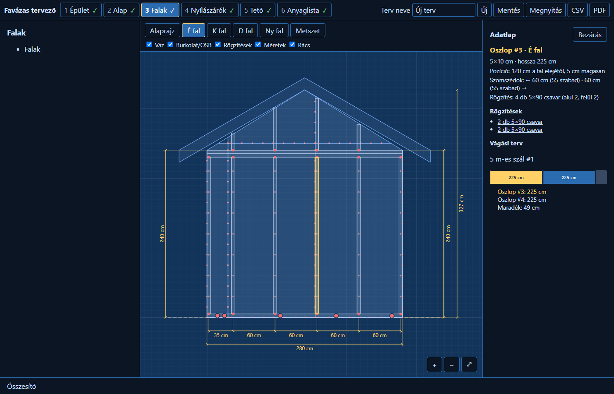
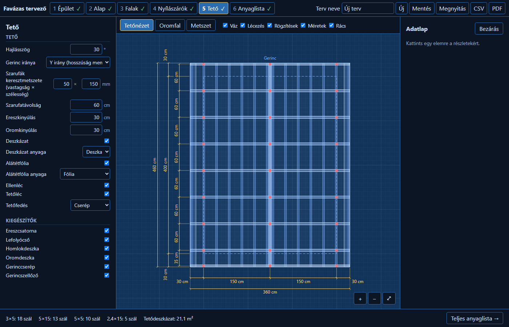

# 🪵 Holzhaus-Planer

**Favázas kerti ház tervező a böngészőben. Méretezd át a házat, és minden azonnal újraszámolódik, a betonlemeztől a gerinccserépig.**

A Holzhaus-Planer egy téglalap alaprajzú, könnyűszerkezetes (favázas) kerti épület (szerszámos ház, műhely, kerti szoba) megtervezésére készült. A méretek, a rétegrend és a tetőforma megadása után a program elkészíti:

- a **teljes anyaglistát** rétegenként, a számítás menetével együtt;
- a **méretezett tervrajzokat** (alaprajz, falnézetek, metszet, tető, alap);
- a **vágási tervet**: melyik darab melyik szálból jön ki, és mennyi a maradék;
- a **rögzítési pontokat** a rajzon, darabszámra egyezően az anyaglistával.



---

## ✨ Funkciók

### Lépésről lépésre
A felület hat lépésre bomlik, amelyek között szabadon lehet ugrálni:

| Lépés | Amit itt beállítasz |
|---|---|
| **1. Épület** | szélesség, hosszúság, falmagasság, tetőforma (lapos / félnyereg / nyereg) |
| **2. Alap** | betonlemez vastagsága, betonminőség, sóderágy, betonháló, opcionális fa padló |
| **3. Falak** | oszlop-keresztmetszet és -kiosztás, koszorú, rétegrend (belső burkolat, párazáró, szigetelés, OSB, szélzáró, léc, külső burkolat) |
| **4. Nyílászárók** | ajtók és ablakok mérete, helye, mellvédmagassága; húzással is mozgathatók |
| **5. Tető** | dőlésszög, szarufa, túlnyúlások, deszkázat / OSB, alátétfólia, ellenléc, tetőléc, héjazat (cserép, trapézlemez, zsindely, EPDM), kiegészítők |
| **6. Anyaglista** | ráhagyások, kereshető anyaglista, vágási terv |

A lépésjelen ✓ mutatja, ha minden mező rendben van, és piros pötty, ha valahol hiba van. A program ilyenkor is az utolsó érvényes állapotot rajzolja és számolja.

### Interaktív tervrajz
- Sötét, „kék tervrajz” stílusú, **nagyítható és mozgatható** rajzvászon (görgő, szóköz + húzás, `+` `−` `0`).
- **Rétegek** ki-be kapcsolhatók: váz, burkolat/OSB, lécezés, rögzítések, méretek, rács.
- **Egérrel ráállva** minden elemről buborék jelenik meg: méret, pozíció, szomszédoktól mért távolság, rögzítés. Közben **ideiglenes méretvonalak** mutatják a távolságokat.
- **Kattintásra** adatlap nyílik, benne a **vágási tervvel**. A `←` `→` billentyűkkel lehet a szomszédos elemre lépni.
- A **rögzítési pontok** típus szerint megkülönböztetve jelennek meg: ászokcsavar, vázcsavar, OSB-csavar, viharkapocs.
- A feliratok és jelölések **minden nagyításnál olvashatók** maradnak.



### 3D nézet
- A felső sáv **3D** gombja lebegő ablakot nyit a rajzvászon fölött: a teljes ház térben, rétegenként saját színnel (váz, OSB, fóliák, szigetelés, burkolatok, tető, nyílászárók).
- Az ablak a fejlécénél fogva **mozgatható**, a sarkánál **átméretezhető**, és ⤢ gombbal a teljes vászonra nagyítható. Helye, mérete és a rétegek állapota megmarad.
- **Forgatás** bal egérgombbal, **nagyítás** görgővel, **mozgatás** jobb gombbal vagy Shift + bal gombbal. Gyorsnézetek: **Persp.**, **É**, **K**, **D**, **Ny**, **Felül**, ⟲ alaphelyzet.
- A **Rétegek** panelen minden réteg külön ki-be kapcsolható; a **Csak váz** gomb a burkolatok nélküli vázszerkezetet mutatja.
- **Ráállva** az elem neve buborékban jelenik meg, **kattintásra** kijelölődik: megnyílik az adatlapja, a 2D rajz pedig átvált arra a nézetre, amelyik ábrázolja. A 2D-ben kijelölt elem a 3D-ben is kiemelődik.
- A 3D rész csak az ablak első megnyitásakor töltődik be, így az alkalmazás indulását nem lassítja. WebGL-képes böngésző kell hozzá.

### Anyaglista, ami meg is magyarázza magát
Minden sor mellett ott a számítás, például:

> 13,44 m² × 0,12 m = 1,6128 m³ beton × 300 kg/m³ = 483,84 kg → **484 kg cement (20 zsák)**

- **Alap:** beton, cement (kg és zsák), betonsóder, víz, betonháló (tábla és kg), zúzottkő ágy, PE fólia, zsaluzás.
- **Falak és tető:** faanyag szálhosszra optimalizálva (pl. „Fenyő palló 50×100, 5 m – 18 szál”), OSB, szigetelés, fóliák, burkolatok, héjazat.
- **Kiegészítők:** ereszcsatorna, toldók, tartók, lefolyó, homlok- és oromdeszka, gerinccserép.
- **Kötőelemek:** ászokcsavar, vázcsavar, OSB-csavar, viharkapocs, szegek. Ahol a rajz megmutatja a pontokat, a darabszám pontosan ezekből jön.
- A **„Mutasd a rajzon”** gombra a program a megfelelő nézetre ugrik, és kiemeli az érintett elemeket.

### Export és mentés
- **PDF:** címlap, tervrajzok világos nyomtatási színekkel, anyaglista és vágási terv. A magyar ékezetekhez beágyazott betűkészletet használ.
- **CSV:** az anyaglista Excelben megnyitható formában (UTF-8, pontosvessző, tizedesvessző).
- **JSON:** a terv mentése és visszatöltése. A betöltés minden mezőt ellenőriz.

---

## 🚀 Indítás

Szükséges hozzá a [Node.js](https://nodejs.org/) 20-as vagy újabb verziója.

```bash
git clone https://github.com/HernyikRichard/Holzhaus-Planer.git
cd Holzhaus-Planer
npm install
npm run dev
```

Ezután nyisd meg a kiírt címet (általában `http://localhost:5173`).

| Parancs | Mit csinál |
|---|---|
| `npm run dev` | fejlesztői szerver, azonnali frissítéssel |
| `npm run build` | típusellenőrzés és éles build a `dist/` mappába |
| `npm test` | az összes automatikus teszt futtatása |

Az éles build statikus fájlokból áll, így bármilyen webtárhelyre (pl. GitHub Pages) feltehető.

---

## 🧱 Felépítés

```
src/
  model/     a terv adatmodellje, alapértékek, validáció, mentés/betöltés
  catalog/   szabványos termékméretek és alapértékek (OSB tábla, betonháló, cementzsák, …)
  calc/      számítómotor: alap, padló, falak, nyílászárók, tető, kiegészítők, kötőelemek, darabolás
  scene/     elemlista: minden oszlop, szarufa, tábla és csavar saját azonosítóval és helyzettel
  viewer/    SVG-tervrajzok, kamera (nagyítás/mozgatás), rétegek, kiemelés
  three-d/   3D modell az elemlistából és a rétegrendből; Three.js-kirajzoló (külön, lusta betöltésű csomag)
  app/       Preact-felület: lépések, rajzvászon, buborék, adatlap, anyaglista, vágási terv
  export/    PDF, CSV, letöltés
```

A számítás és a rajz **ugyanabból az elemlistából** dolgozik, ezért ami a rajzon látszik, az szerepel az anyaglistában is, és fordítva.

**Technológia:** TypeScript · Preact · Vite · Vitest · jsPDF + svg2pdf.js · Three.js

---

## ⚠️ Fontos tudnivalók

- A program **nem végez statikai méretezést**. Ha a szarufa fesztávja a keresztmetszetéhez képest túl nagy, figyelmeztet, de a szerkezetet építés előtt **szakemberrel ellenőriztesd**.
- A mennyiségek **becslések** a megadott ráhagyásokkal. Rendelés előtt érdemes a tüzéppel egyeztetni a kapható méreteket.
- Jelenleg csak **téglalap alaprajzú**, válaszfal nélküli épületet és **betonlemez** alapozást kezel. Árakat nem számol.
